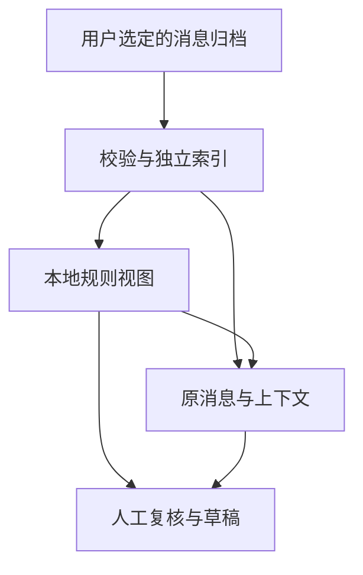

# 架构与证据流

v0.4.0 是源码运行的本机应用。Python 提供本地 HTTP 服务、规范归档导入、SQLite 索引和规则引擎；HTML/CSS/JavaScript 提供界面。演示和规范归档查看不需要第三方 Python 包。

## 三种数据角色

**归档**是用户明确选定的消息来源。导入器建立独立的 `index.sqlite`，保留浏览和查询需要的消息字段；归档仍保留导出清单、解码状态和来源表统计等更完整的审计信息。原微信数据库不被浏览服务直接打开。

**候选和图谱**由 `world_model.py` 在只读索引上计算。它使用本地关键词、正则表达式、固定讨论窗口和有限样本，不调用模型或网络服务。计算结果可重新生成；它们不替代来源证据。

**人工工作状态**写入单独的 `workspace.sqlite`，包含复核状态、备注、草稿及其来源指纹。对工作状态的修改不改写消息归档或索引。生成时的草稿被保留，来源变化通过过期标识呈现。



## 核心模块

| 模块 | 责任 |
|---|---|
| `personal_world.py` | 用户入口：演示、打开、导入、配置、刷新、诊断和验证 |
| `app_config.py` | 状态目录、私有配置、进程锁、解释器与可选依赖检查 |
| `server.py` | 归档索引、只监听回环地址的服务、聊天和工作空间 API、本地媒体访问 |
| `world_model.py` | 有证据的主题与信号、讨论候选、时间线、图谱、人工复核与模板草稿 |
| `draft_store.py` | 草稿版本的追加保存、并发版本校验和旧工作数据库只读兼容 |
| `world.html` / `index.html` | 个人工作空间与聊天历史界面 |
| `sync_wechat.py` | 已有密钥条件下的只读快照、数据库内容归一化和逐表核对 |
| `append_chatbot.py` | 支持的本地聊天机器人消息子系统适配；不是云模型客户端 |
| `enrich_media.py` | 现存本地媒体和头像的安全映射、格式解码与缓存 |
| `refresh.py` / `verify_archive.py` | 手动刷新管线及归档、索引、来源清单与媒体状态核对 |

可选微信适配器需要独立依赖。它从原目录复制选定数据库和 WAL，确认复制期间来源稳定，再只读打开副本并进行完整性检查。媒体模块也使用自己的选定快照。详细范围见 [微信导入](wechat-import.md)。

## 候选与图谱的含义

候选分组键是会话、第一条命中的规则主题和固定 30 天窗口。信号来自正文中的需求、供给、合作措辞；公告过滤和推进反例减少部分误报，但不构成语义理解。

跨会话关联只连接共享具体主题的需求/供给讨论，并给出另一方的锚点消息。它没有核实价格、规格、可用时间或联系意愿。每个候选最多列举少量关联线索，不是穷尽匹配。

图谱的“人物”是会话范围内的发送者显示名，不是全局身份。边表示发言或提及；不推断真实朋友关系、雇佣、合作或信任。命中数量、样本数量和截断标记分开返回。

## 本机访问与发布边界

服务固定绑定 `127.0.0.1`，数据 API 需要每个状态目录独立的 HttpOnly Cookie。写接口仅允许同源保存人工复核与模板草稿。静态页面可在未连接时说明如何启动，但没有凭据不能读取数据 API。

读取和更新索引分离：新归档/索引通过检查后才替换当前版本。浏览中的请求读取自己的 SQLite 视图。证据指纹帮助发现更新后旧人工记录与当前依据不一致；它不认证来源消息的真实性。

源码仓库与私人状态目录必须分开。源代码发行包包含人工示例，不包含密钥、微信二进制、数据库、媒体或本机依赖目录。

实现依据：[server.py](../server.py)、[world_model.py](../world_model.py)、[sync_wechat.py](../sync_wechat.py)、[enrich_media.py](../enrich_media.py)。

## 工作记录的版本与真实浏览器验证

生成稿保存在原 `drafts` 表中且不更新。人工编辑追加到 `draft_revisions`，主键为草稿 ID 与递增版本。读取时叠加最新版本；只读访问不创建或迁移数据库。关联推荐在证据计算之后单独应用当前复核状态，避免人工作业污染来源指纹或计算缓存。

真实浏览器检查可在 Node 24 和已有 Chromium 上运行：

```sh
PYTHON=python3 CHROME_BIN=/path/to/chrome node scripts/test_browser.mjs
```

检查使用手写示例、临时状态目录和独立的临时 Chromium 配置，覆盖实际页面渲染、保存、完整页面重载和手机宽度布局。可以用 `PW_VISUAL_OUTPUT` 指定源码目录外的截图位置。它不会连接已有登录态或安装浏览器；仍不代表所有浏览器、全部辅助技术或所有媒体格式已经完成审计。

## 历史集合

`history_import.py` 负责规范输入校验、命名空间、预览计划、来源快照、稳定ID合并、增量索引写入及来源逐条审计；`archive_publish.py` 负责受已有状态锁保护的双文件发布日志和恢复。

当前集合只保留统一消息字段及 origin。原有原生来源清单保存在各批次的规范输入中，不能拿多批次来源的表计数冒充某次完整数据库导出。集合验证使用既有统一字段核对，再验证每个来源文件的哈希和每条消息/会话对应的输入记录。

全文搜索为外部内容FTS5表时，变化文字先删除原来的FTS条目，再写入新文本；无变化文字不重写。构建在备份得到的独立索引副本上进行，校验后才发布。输入读取和规范集合文件仍是完整扫描/生成。

## 自我画像模块

`personal_profile.py` 在已有只读索引上计算主来源本人文本的规则候选，`profile.html` 提供独立的人工确认界面。控制文件与归档分离，画像写入使用共享StateLock、原子JSON及revision并发检查。模块没有网络依赖，候选不自动持久化。完整状态与数据使用边界见 [personal-profile.md](personal-profile.md)。
